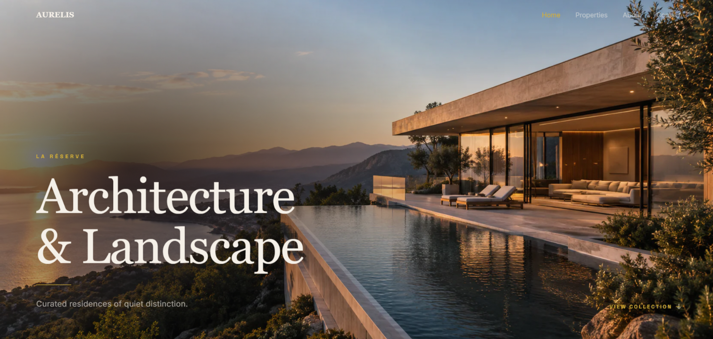

 

  

&nbsp;

---

### 01 / THE INTRODUCTION

# Building with purpose.

I'm Aman, a frontend developer interested in creating digital experiences where **visual design meets thoughtful engineering**.

I focus on translating ideas into polished interfaces through typography, layout, responsive design and meaningful motion.

My approach is simple: every detail should have a reason to exist.

---

### 02 / SELECTED WORK

# A collection of ideas.

<table>
<tr>
<td width="50%" valign="top">

### AURELIS

**LUXURY REAL ESTATE EXPERIENCE**

An architectural real-estate website concept built around immersive visuals, refined typography and editorial storytelling.

**STACK**

React · JavaScript · Vite · Tailwind CSS · GSAP

<a href="https://aurelis-roan.vercel.app/">EXPLORE PROJECT ↗</a>

 

<a href="https://github.com/aman-karmakar-dev/AURELIS">SOURCE CODE ↗</a>

</td>
<td width="50%" valign="top">

### PERSONAL PORTFOLIO

**DARK EDITORIAL EXPERIENCE**

A personal digital portfolio presenting frontend work, interface design and a design-focused development approach.

**STACK**

React · JavaScript · Vite · Tailwind CSS · GSAP · Motion

<a href="https://aman-karmakar.vercel.app">EXPLORE PROJECT ↗</a>

 

<a href="https://github.com/aman-karmakar-dev/portfolio">SOURCE CODE ↗</a>

</td>
</tr>
</table>

---

### 03 / CAPABILITIES

# The tools behind the work.

**FRONTEND DEVELOPMENT**

**STYLING & MOTION**

**DESIGN & WORKFLOW**

---

### 04 / CURRENT DIRECTION

# Always refining.

- Exploring advanced frontend development.
- Building visually considered interfaces.
- Learning more about motion design and interaction.
- Improving responsive design and component architecture.
- Experimenting with new technologies and creative approaches.

---

### 05 / GITHUB ACTIVITY

---

### 06 / LET'S CONNECT

# Have an idea worth building?

I'm interested in thoughtful projects, creative collaborations and opportunities to build better digital experiences.

 

  

<a href="https://github.com/aman-karmakar-dev">GITHUB</a>
&nbsp; · &nbsp;
<a href="https://aman-karmakar.vercel.app">PORTFOLIO</a>

  

DESIGNED WITH INTENT · BUILT WITH CURIOSITY

 

