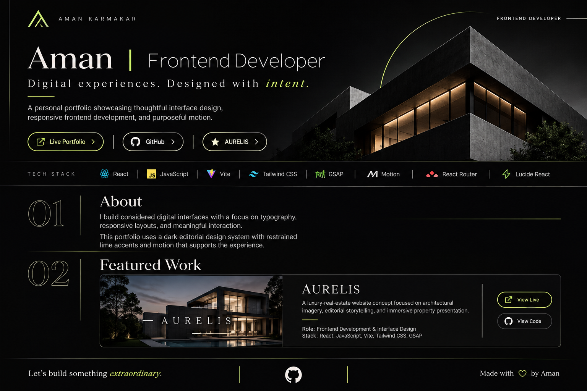

<p align="center">
  
</p>

<h1 align="center">Aman | Frontend Developer</h1>

<p align="center">
  <strong>Digital experiences. Designed with intent.</strong>
</p>

<p align="center">
  <a href="https://aman-karmakar.vercel.app">VIEW PORTFOLIO ↗</a>
  &nbsp; · &nbsp;
  <a href="https://aurelis-roan.vercel.app">EXPLORE AURELIS ↗</a>
</p>

---

## 01 / About

I build considered digital interfaces with a focus on typography, responsive layouts, accessibility, and meaningful interaction.

My approach combines thoughtful visual design with purposeful frontend development. Every interaction, transition, and layout decision should contribute to the overall experience.

---

## 02 / Featured Project

### AURELIS

A luxury real-estate website concept focused on architectural imagery, editorial storytelling, and immersive property presentation.

<p align="center">
  <a href="https://aurelis-roan.vercel.app">
    <strong>EXPLORE THE LIVE EXPERIENCE ↗</strong>
  </a>
</p>

- **Role:** Frontend Development & Interface Design
- **Stack:** React, JavaScript, Vite, Tailwind CSS, GSAP
- **Focus:** Responsive layouts, animation, typography, and visual storytelling
- **Status:** Live

---

## 03 / Tech Stack

<p align="center">
  
  
  
  
  
  
</p>

**Also working with:**

- React Router
- Lucide React
- CSS animations
- Responsive UI development

---

## 04 / Run Locally

Clone the repository:

```bash
git clone https://github.com/akashkarmakar1693-hue/portfolio.git
```

Navigate into the project:

```bash
cd portfolio
```

Install dependencies:

```bash
npm install
```

Start the development server:

```bash
npm run dev
```

### Production Build

```bash
npm run build
npm run preview
```

---

## 05 / Connect

<p align="center">
  <a href="https://aman-karmakar.vercel.app">PORTFOLIO</a>
  &nbsp; · &nbsp;
  <a href="https://github.com/akashkarmakar1693-hue">GITHUB</a>
  &nbsp; · &nbsp;
  <a href="https://aurelis-roan.vercel.app">AURELIS</a>
</p>

<p align="center">
  <strong>Designed with intent. Built with purpose.</strong>
  <br />
  <sub>© Aman · Frontend Developer</sub>
</p>
