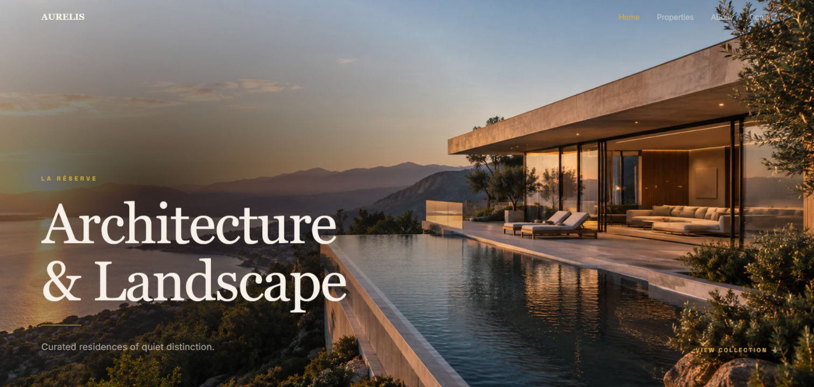
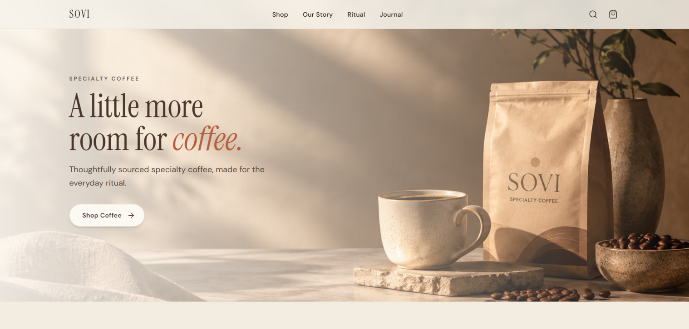
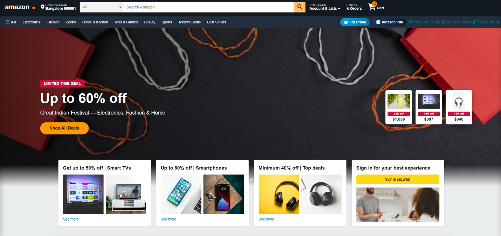

<!-- ──────────────────────────────────────────────────────────── -->
<!--              AMAN KARMAKAR / PORTFOLIO                       -->
<!-- ──────────────────────────────────────────────────────────── -->

<div align="center">


<br/>

<a href="https://aman-karmakar.vercel.app">
  
</a>
&nbsp;
<a href="https://github.com/aman-karmakar-dev">
  
</a>

<br/><br/>

<sub>REACT · JAVASCRIPT · INTERACTION · VISUAL DESIGN</sub>

</div>

---

<div align="center">

### 01 / THE PROJECT

# A personal space for digital work.

</div>

This repository contains my personal frontend development portfolio — a place to present selected projects, design thinking and development capabilities through a carefully crafted digital experience.

The direction combines **dark editorial design**, expressive typography, structured layouts and purposeful motion.

<br/>

<table>
<tr>
<td width="50%" valign="top">

**DESIGN DIRECTION**

Dark Editorial

Minimal Architecture

Typography-led Layouts

</td>
<td width="50%" valign="top">

**EXPERIENCE**

Responsive Interface

Smooth Interactions

Motion-led Details

</td>
</tr>
</table>

---

<div align="center">

### 02 / DESIGN SYSTEM

# Less noise. More intention.

</div>

| ELEMENT | DIRECTION |
|:--|:--|
| Background | Obsidian `#0B0C0E` |
| Primary text | Warm White `#F1EEE7` |
| Accent | Lime `#C4F56A` |
| Surface | `#141518` |
| Muted text | `#858585` |
| Display type | Space Grotesk |
| Body type | Inter |
| Editorial type | Instrument Serif |

The visual system uses restrained contrast, fine borders and typography to create a consistent identity without unnecessary decoration. Fonts are self-hosted — no external font requests.

---

<div align="center">

### 03 / SELECTED WORK

# Three builds, one standard.

</div>

### 01 — AURELIS

<a href="https://aurelis-roan.vercel.app/">

</a>

**LUXURY REAL ESTATE EXPERIENCE**

A premium real-estate website concept focused on architectural storytelling, immersive interfaces and refined web animations.

`REACT` &nbsp; `JAVASCRIPT` &nbsp; `VITE` &nbsp; `TAILWIND CSS` &nbsp; `GSAP`

<a href="https://aurelis-roan.vercel.app/">Live experience ↗</a>
&nbsp; · &nbsp;
<a href="https://github.com/aman-karmakar-dev/AURELIS">Source code ↗</a>
&nbsp; · &nbsp;
<a href="https://aman-karmakar.vercel.app/work/aurelis">Case study ↗</a>

<br/>

### 02 — SOVI

<a href="https://sovi-coffee.vercel.app/">

</a>

**SPECIALTY COFFEE STOREFRONT**

A premium coffee storefront for a small-batch roaster — warm editorial branding, a three-step brew ritual, a journal and a newsletter signup. Live in production.

`REACT` &nbsp; `JAVASCRIPT` &nbsp; `TAILWIND CSS` &nbsp; `GSAP` &nbsp; `MOTION`

<a href="https://sovi-coffee.vercel.app/">Live experience ↗</a>
&nbsp; · &nbsp;
<a href="https://aman-karmakar.vercel.app/work/sovi">Case study ↗</a>

<br/>

### 03 — AMAZON CLONE



**E-COMMERCE FRONTEND**

An e-commerce frontend inspired by Amazon's shopping experience, with product search, category filtering, product details, cart, quantity updates and localStorage persistence.

`HTML` &nbsp; `CSS` &nbsp; `JAVASCRIPT`

---

<div align="center">

### 04 / TECHNOLOGY

# The toolkit

<br/>


<br/><br/>


</div>

---

<div align="center">

### 05 / UNDER THE HOOD

# Project architecture

</div>

| AREA | IMPLEMENTATION |
|:--|:--|
| Framework | React 19 |
| Build tool | Vite 8 |
| Language | JavaScript (JSX, never TypeScript) |
| Styling | Tailwind CSS 4 |
| Animation | GSAP + `@gsap/react`, Motion |
| Routing | React Router 7 |
| Icons | Lucide React |
| Typography | Self-hosted Space Grotesk, Inter, Instrument Serif |

**Application routes**

- `/` — main portfolio experience
- `/work/aurelis` — AURELIS project case study
- `/work/sovi` — SOVI project case study

**Additional implementation details**

- Shared site layout with responsive navigation and footer.
- Reduced-motion accessibility support via `prefers-reduced-motion` and Motion's `useReducedMotion`.
- Custom design tokens and reusable styling.
- Enquiry form backed by Web3Forms (key supplied via environment variable).

---

<div align="center">

### 06 / RUN LOCALLY

# Get started

</div>

Clone the repository and run the development server:

```bash
git clone https://github.com/aman-karmakar-dev/portfolio.git

cd portfolio

npm install

npm run dev
```

**Production build**

```bash
npm run build
```

**Lint**

```bash
npm run lint
```

**Contact form (optional)**

The enquiry form submits through [Web3Forms](https://web3forms.com). It works in production when an access key is configured; without one the form shows an error state instead of sending. To run it locally:

```bash
cp .env.example .env.local
# set VITE_WEB3FORMS_ACCESS_KEY in .env.local — never commit it
```

`.env.local` is git-ignored. Only `.env.example` is committed, with no values.

---

<div align="center">

### 07 / EXPLORE

# Experience the portfolio.

<br/>

<a href="https://aman-karmakar.vercel.app">
  
</a>

<br/><br/>

<a href="https://github.com/aman-karmakar-dev">GITHUB PROFILE</a>
&nbsp; · &nbsp;
<a href="https://aurelis-roan.vercel.app/">AURELIS PROJECT</a>
&nbsp; · &nbsp;
<a href="https://sovi-coffee.vercel.app/">SOVI PROJECT</a>

<br/><br/>

<sub>DESIGNED WITH INTENTION · BUILT WITH PRECISION</sub>

<br/><br/>


</div>
